# 小芽分帳 (Split System)

Cross-platform web application for group expense tracking, running tabs, and trip planning, built on Cloudflare edge serverless and React.

---

## Prerequisites

- **Node.js**: `>= 22.12.0` (see `.nvmrc`)
- **pnpm**: `>= 10.18.3`

---

## Quick Start (Local Development)

### 1. Install Dependencies

```bash
pnpm install
```

### 2. Start Everything

```bash
pnpm dev
```

This one command:

- creates `apps/worker/.dev.vars` from `.dev.vars.example` if it is missing (a dev-only session signing key, plus `TEST_SIGN_IN=1` for the local test sign-in),
- applies pending migrations to the local D1 database and starts the Worker API on port `8787`,
- starts the Vite frontend on port `5173`, which proxies `/api` to `8787`.

Open your browser at:
👉 **[http://localhost:5173](http://localhost:5173)**

On the sign-in page, use the **測試登入（僅限本機）** form: type any display name and press 測試登入. Stop both servers with `Ctrl+C`.

> Open `5173`, not `8787`: the Worker port only serves the API. If the sign-in shows "找不到這筆資料", `apps/worker/.dev.vars` is missing or was added while the Worker was running — restart `pnpm dev`.

To open it on a phone on the same Wi-Fi, use the `Network:` address that `pnpm dev` prints for Vite (for example `http://192.168.68.55:5173`). Only `5173` is needed: the phone never talks to `8787` directly. On WSL2 with `networkingMode=mirrored`, Windows may block the incoming connection; if the phone times out, run this once in an administrator PowerShell:

```powershell
Set-NetFirewallHyperVVMSetting -Name '{40E0AC32-46A5-438A-A0B2-2B479E8F2E90}' -DefaultInboundAction Allow
```

> **After the database changes** (a new currency or a new setting on a not-yet-released migration), the old local database no longer matches. Stop `pnpm dev`, delete the local state with `rm -rf apps/worker/.wrangler/state`, and start it again; the migrations recreate it. Your local test groups are lost, which is fine for development.

To run the two servers separately (for example in two terminals):

```bash
pnpm --filter @split/worker dev
pnpm --filter @split/web dev
```

---

## Testing & Quality Checks

Run all verification suites locally before committing:

### Unit & Integration Tests

Runs Vitest tests across all packages:

```bash
pnpm test
```

Or for a specific package:

```bash
pnpm --filter @split/shared test
pnpm --filter @split/worker test
pnpm --filter @split/web test
```

### Type Checking

```bash
pnpm typecheck
```

### Linting & Formatting

```bash
pnpm lint
pnpm format:check
```

Auto-format files:

```bash
pnpm format
```

### End-to-End (E2E) Tests

Runs the full Playwright suite against local Worker instances (verifying the golden path and production safety checks):

```bash
pnpm e2e
```

---

## Project Structure

```text
├── apps/
│   ├── web/          # React 19 SPA, Tailwind CSS v4, Vite, Radix UI primitives
│   └── worker/       # Cloudflare Worker, Hono API, D1 (Drizzle ORM), LINE webhook
├── packages/
│   └── shared/       # Shared money core, debt simplification & payment plan engine
├── e2e/              # Playwright E2E test suites
└── docs/             # Product specifications, wayfinder decision records & release checklist
```

---

## 系統架構與設計圖 (System Design & Architecture)

### 1. 前後端系統架構圖 (System Architecture)

展示 React SPA 前端、LINE LIFF、Cloudflare Workers 邊緣運算層、D1 關聯式資料庫及外部 OAuth 身分驗證的整合架構：



> 💡 可直接在瀏覽器開啟出版級向量頁面：[`docs/diagrams/architecture.html`](docs/diagrams/architecture.html)

---

### 2. LINE 登入流程時序圖 (LINE Authentication Sequence)

展示使用者從點擊 LINE 登入、LIFF SDK 換取 OpenID Token、Cloudflare Worker 進行 JWKS 簽章驗證、寫入 D1 資料庫並建立 Session 的完整時序：



> 💡 可直接在瀏覽器開啟出版級向量頁面：[`docs/diagrams/line-auth-sequence.html`](docs/diagrams/line-auth-sequence.html)

---

### 3. D1 資料庫實體關聯圖 (Database Schema & ER)

展示核心資料表（`users`、`identities`、`groups`、`members`、`expenses`）之欄位、SQL 型態、主鍵與外鍵級聯（Cascade）關聯：



> 💡 可直接在瀏覽器開啟出版級向量頁面：[`docs/diagrams/db-schema-er.html`](docs/diagrams/db-schema-er.html)
